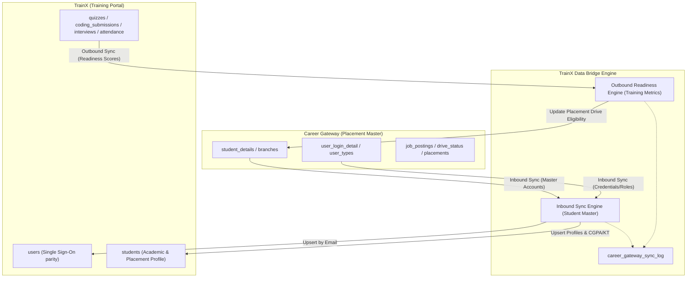

# TrainX & Career Gateway Database Integration Guide

This guide provides technical specifications, architectural standards, and data contract mappings to integrate **TrainX (Training & Learning Portal)** with **Career Gateway (TPO & Campus Placements Portal)**.

---

## 1. System Overview & Architecture

TrainX and Career Gateway operate as complementary platforms within the institutional ecosystem:
- **Career Gateway**: The primary system for corporate relationships, job postings, placement drives, recruiter interactions, and overall student eligibility management.
- **TrainX**: The primary platform for academic cohorts, skill training, coding practice, attendance tracking, faculty mentorship, and AI mock interview readiness.

### Integration Topology: Selective Sync / Data Bridge
The platforms communicate through a **Selective Sync Data Bridge** hosted across the MySQL database network.



---

## 2. Core Integration Rules & Master Authorities

| Data Domain | Master System (Source of Truth) | Receiving System | Sync Direction | Key Identifier |
| :--- | :--- | :--- | :---: | :--- |
| **Student Registration & Credentials** | **Career Gateway** | TrainX | `Inbound` | Institutional Email (`email`) |
| **Academic Standing (CGPA, Backlogs)** | **Career Gateway** | TrainX | `Inbound` | Institutional Email (`email`) |
| **Placement Status & Company Offer** | **Career Gateway** | TrainX | `Inbound` | Institutional Email (`email`) |
| **Training Attendance %** | **TrainX** | Career Gateway | `Outbound` | Institutional Email (`email`) |
| **Cumulative Assessment Score** | **TrainX** | Career Gateway | `Outbound` | Institutional Email (`email`) |
| **Coding Problems Solved Count** | **TrainX** | Career Gateway | `Outbound` | Institutional Email (`email`) |
| **AI Mock Interview Ratings** | **TrainX** | Career Gateway | `Outbound` | Institutional Email (`email`) |
| **Mentorship Defaulter / Risk Flag** | **TrainX** | Career Gateway | `Outbound` | Institutional Email (`email`) |

> [!IMPORTANT]
> **Universal Identifier Rule:** All student mapping between Career Gateway and TrainX is strictly matched on lowercased, trimmed **Institutional Email (`email`)**. University Roll Numbers (`roll_number` / `roll_no`) are maintained as secondary cross-references.

---

## 3. Database Schemas Provided in this Release

This repository package contains the complete, canonical TrainX database schemas:

1. **Complete Database Schema (All 90 Tables):**
   - **Path:** [`database/trainx_complete_schema.sql`](file:///c:/Users/paksh/Desktop/Training%20Portal/database/trainx_complete_schema.sql)
   - Contains all production table definitions, constraints, indexes, and foreign keys. Can be imported into MySQL with:
     ```bash
     mysql -u root -p training_portal_db < database/trainx_complete_schema.sql
     ```

2. **Delta Migration Script (Career Gateway Compatibility):**
   - **Path:** [`database/migrations/20261102_career_gateway_compatibility.sql`](file:///c:/Users/paksh/Desktop/Training%20Portal/database/migrations/20261102_career_gateway_compatibility.sql)
   - An idempotent MySQL 8.0+ script that safely adds Career Gateway fields (`cgpa`, `live_kt`, `placement_status`, `linkedin_url`, `portfolio_link`, `cg_synced_at`, and `career_gateway_sync_log`).

3. **Auto-Migrator Module:**
   - **Path:** [`Backend/src/config/migrator.js`](file:///c:/Users/paksh/Desktop/Training%20Portal/Backend/src/config/migrator.js)
   - Runs automatically on backend startup (`server.js`) and records completed migrations in `schema_migrations`.

---

## 4. Field Mapping Contracts

### A. Inbound Data Contract: Career Gateway → TrainX
Ingests student accounts and profile information into TrainX so students can log in and participate in training cohorts without creating duplicate accounts.

| Career Gateway Column (`student_details` / `user_login_detail`) | TrainX Destination (`users` / `students`) | Type | Description / Transformation |
| :--- | :--- | :--- | :--- |
| `email` | `users.email`, `students.email` | `VARCHAR(255)` | Lowercased & trimmed universal primary identifier. |
| `name` | `users.name` | `VARCHAR(255)` | Student's full name. |
| `mobile` / `mobile_number` | `users.mobile_number`, `students.mobile_number` | `VARCHAR(20)` | Contact mobile number. |
| `password` | `users.password_hash` | `VARCHAR(255)` | Password hash to maintain Single Sign-On capability. |
| `roll_no` / `stud_clg_id` | `students.roll_number` | `VARCHAR(100)` | College enrollment / roll ID. |
| `branch` / `branch_code` | `students.department`, `students.department_id` | `VARCHAR(100)` | Standardized code lookup (`COMPS`, `IT`, `EXTC`, `MECH`). |
| `degree_year` | `students.year` | `VARCHAR(20)` | Academic year (`FE`, `SE`, `TE`, `BE`). |
| `division` | `students.division` | `VARCHAR(20)` | Division (`A`, `B`, `C`). |
| `semester` | `students.semester` | `VARCHAR(20)` | Semester label or number (`Semester 5`). |
| `cgpa` | `students.cgpa` | `DECIMAL(4,2)` | University cumulative GPA (e.g. `8.75`). |
| `live_kt` | `students.live_kt` | `INT` | Number of active/uncleared backlogs. |
| `dead_kt` | `students.dead_kt` | `INT` | Number of cleared backlogs. |
| `placement_status` | `students.placement_status` | `VARCHAR(50)` | `Unplaced`, `Placed`, or `Opted Out`. |
| `placed_company` | `students.placed_company` | `VARCHAR(255)` | Company name if already placed. |
| `linkedin_url` | `students.linkedin_url` | `VARCHAR(255)` | Student LinkedIn profile URL. |
| `portfolio_link` | `students.portfolio_link` | `VARCHAR(255)` | Student personal portfolio / GitHub URL. |
| `profile_pic` | `users.profile_pic` | `VARCHAR(255)` | User profile photo URL. |
| *System Timestamp* | `users.cg_synced_at`, `students.cg_synced_at` | `TIMESTAMP` | Recorded timestamp of sync. |

---

### B. Outbound Data Contract: TrainX → Career Gateway
Pushes real-time training evaluation, attendance, and technical readiness scores back into Career Gateway to enforce eligibility rules for campus recruitment drives.

| TrainX Source Metric | Career Gateway Target (`student_details`) | Type | Purpose in Career Gateway Recruitment Drives |
| :--- | :--- | :--- | :--- |
| `weekly_reports.attendance_score` | `trainx_attendance_pct` | `DECIMAL(5,2)` | Placement filter (e.g. require $\ge 75\%$ training attendance). |
| `weekly_reports.overall_score` | `trainx_overall_score` | `DECIMAL(5,2)` | Aggregate student performance score for candidate ranking. |
| `COUNT(DISTINCT practice_problem_submissions.problem_id)` | `trainx_problems_solved` | `INT` | Verified coding aptitude problem count for tech companies. |
| `AVG(interviews.score)` | `trainx_interview_score` | `DECIMAL(5,2)` | AI mock technical interview rating out of 100. |
| *System Timestamp* | `trainx_synced_at` | `TIMESTAMP` | Timestamp when readiness metrics were last refreshed. |

---

## 5. API Reference for Sync Operations

TrainX provides REST endpoints protected by `SUPER_ADMIN` and `COLLEGE_ADMIN` roles for on-demand synchronization:

### 1. Inbound Sync (Ingest Students from Career Gateway)
- **Method:** `POST`
- **Endpoint:** `/api/v1/admin/career-gateway/sync-inbound`
- **Headers:** `Authorization: Bearer <TOKEN>`
- **Response:**
  ```json
  {
    "success": true,
    "message": "Career Gateway inbound student sync completed successfully",
    "data": {
      "total": 162,
      "successCount": 162,
      "failureCount": 0,
      "durationMs": 142
    }
  }
  ```

### 2. Outbound Sync (Push Training Readiness to Career Gateway)
- **Method:** `POST`
- **Endpoint:** `/api/v1/admin/career-gateway/sync-outbound`
- **Headers:** `Authorization: Bearer <TOKEN>`
- **Response:**
  ```json
  {
    "success": true,
    "message": "Career Gateway outbound readiness metrics pushed successfully",
    "data": {
      "total": 162,
      "successCount": 162,
      "failureCount": 0,
      "durationMs": 46
    }
  }
  ```

### 3. Sync Status & Audit Logs
- **Method:** `GET`
- **Endpoint:** `/api/v1/admin/career-gateway/sync-status`
- **Headers:** `Authorization: Bearer <TOKEN>`
- **Response:**
  ```json
  {
    "success": true,
    "data": {
      "overview": {
        "totalStudents": 165,
        "syncedWithCareerGateway": 162,
        "targetDatabase": "acadnexus_db"
      },
      "logs": [
        {
          "id": 12,
          "sync_direction": "outbound_to_cg",
          "entity_type": "students",
          "total_records": 162,
          "success_count": 162,
          "failure_count": 0,
          "status": "success",
          "triggered_by": "scheduled_job",
          "created_at": "2026-11-02T15:20:00.000Z"
        }
      ]
    }
  }
  ```

---

## 6. Audit & Monitoring Table: `career_gateway_sync_log`

Every synchronization execution (inbound or outbound, manual or scheduled) is logged in the `career_gateway_sync_log` table:

```sql
SELECT 
  id,
  sync_direction,
  total_records,
  success_count,
  failure_count,
  status,
  triggered_by,
  created_at
FROM career_gateway_sync_log
ORDER BY id DESC
LIMIT 10;
```

---

## 7. Automated Synchronization Setup

To schedule continuous automated data exchange between TrainX and Career Gateway:

### Option A: Node.js Cron Job (Recommended)
Add a recurring schedule in TrainX background services:
```javascript
import cron from 'node-cron';
import { syncStudentsFromCareerGateway, pushReadinessMetricsToCareerGateway } from './services/careerGatewayBridge.service.js';

// Inbound: Sync newly registered students daily at 02:00 AM
cron.schedule('0 2 * * *', async () => {
  await syncStudentsFromCareerGateway({ triggerSource: 'cron_nightly_inbound' });
});

// Outbound: Push training metrics daily at 04:00 AM
cron.schedule('0 4 * * *', async () => {
  await pushReadinessMetricsToCareerGateway({ triggerSource: 'cron_nightly_outbound' });
});
```

### Option B: Linux Crontab / cURL
Trigger the authenticated API endpoints via scheduled curl script:
```bash
0 2 * * * curl -X POST http://localhost:5000/api/v1/admin/career-gateway/sync-inbound -H "Authorization: Bearer $CRON_TOKEN"
0 4 * * * curl -X POST http://localhost:5000/api/v1/admin/career-gateway/sync-outbound -H "Authorization: Bearer $CRON_TOKEN"
```

---

## 8. Deployment & Integration Checklist

- [x] Apply [`database/migrations/20261102_career_gateway_compatibility.sql`](file:///c:/Users/paksh/Desktop/Training%20Portal/database/migrations/20261102_career_gateway_compatibility.sql) or run `npm run db:migrate`.
- [x] Verify presence of placement columns (`cgpa`, `live_kt`, `placement_status`, `linkedin_url`) in `students` table.
- [x] Configure `CG_DB_NAME` in `Backend/.env` to point to Career Gateway database (default: `acadnexus_db` or `career_gateway_db`).
- [x] Verify Auto-Migrator execution on server startup (`[AutoMigrator] ✨ Database schema is up to date`).
- [x] Test inbound student sync via `POST /api/v1/admin/career-gateway/sync-inbound`.
- [x] Test outbound readiness metric push via `POST /api/v1/admin/career-gateway/sync-outbound`.

