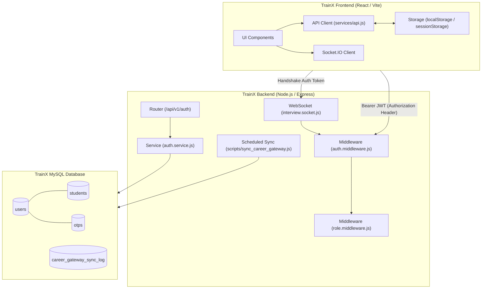
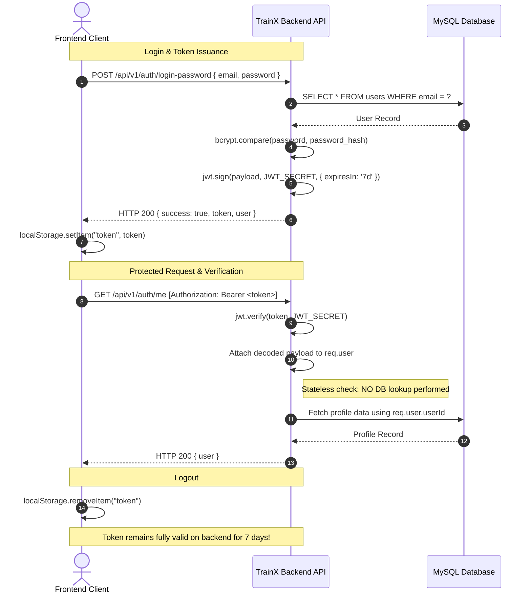
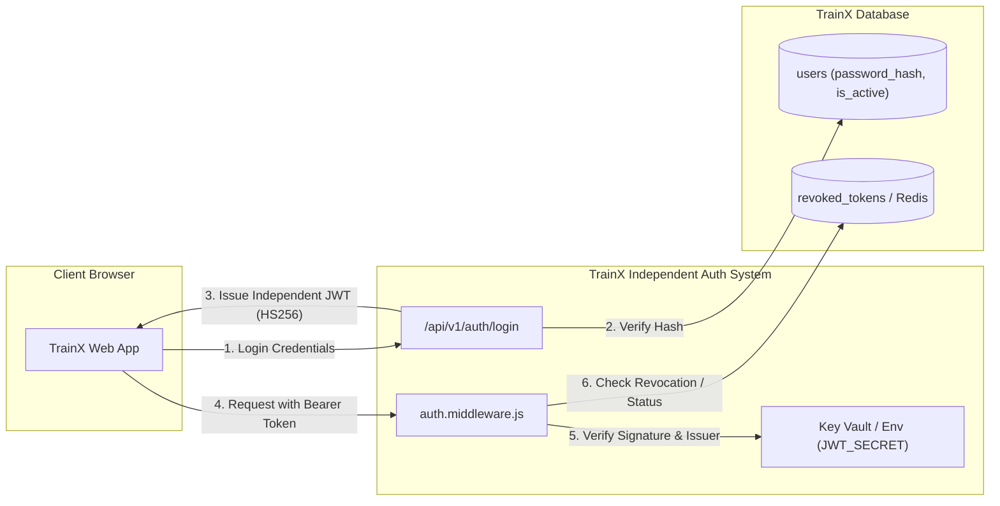
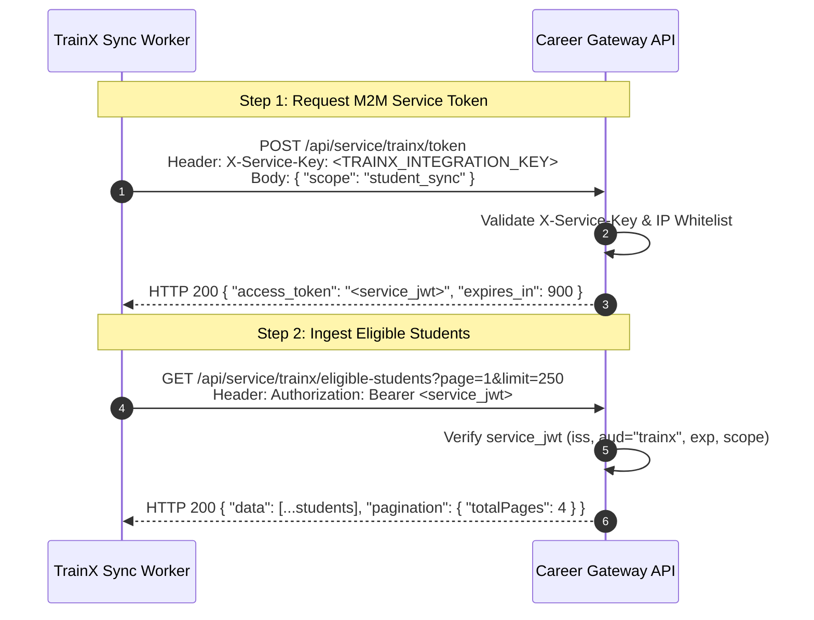
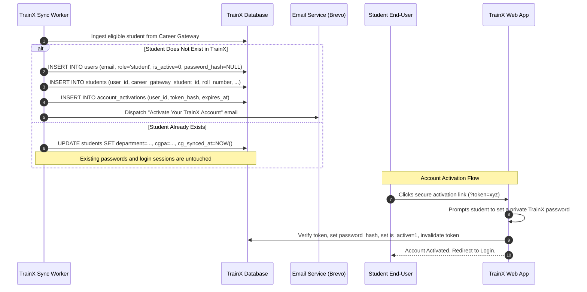
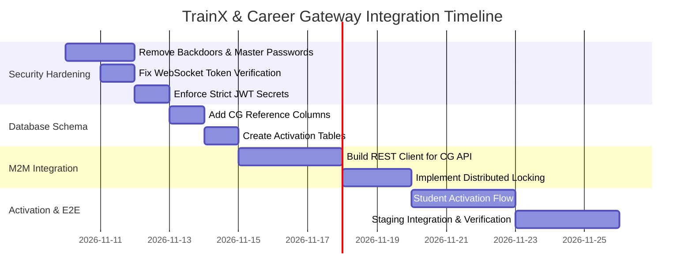

# Forensic Architecture, Security & Authentication Audit: TrainX
## Integration Blueprint with Career Gateway (Master Identity Provider)

---

### Document Information
- **Auditor Roles**: Principal Software Architect, Senior Application Security Engineer, JWT Authentication Specialist, Production Infrastructure Engineer
- **Target Repository**: TrainX (`campus-training-portal`)
- **Integration Target**: Career Gateway (`career-gateway`)
- **Status**: Complete Forensic Audit & Technical Implementation Specification
- **Audit Execution Mode**: Strict Read-Only (Zero Code/Schema Mutations Performed)
- **Date**: November 2026

---

## Table of Contents
1. [Core Architectural Answers (Questions 1–10)](#1-core-architectural-answers)
2. [Executive Summary](#2-executive-summary)
3. [TrainX Architecture Overview](#3-trainx-architecture-overview)
4. [Authentication File Map & Dependencies](#4-authentication-file-map--dependencies)
5. [Exact TrainX JWT Configuration](#5-exact-trainx-jwt-configuration)
6. [Exact TrainX JWT Payloads & Token Inconsistencies](#6-exact-trainx-jwt-payloads--token-inconsistencies)
7. [Existing Authentication Lifecycle & Transport Analysis](#7-existing-authentication-lifecycle--transport-analysis)
8. [Existing Authorization & Role-Based Access Control (RBAC)](#8-existing-authorization--role-based-access-control-rbac)
9. [TrainX Database & User Identity Structure](#9-trainx-database--user-identity-structure)
10. [Career Gateway vs. TrainX Compatibility Matrix](#10-career-gateway-vs-trainx-compatibility-matrix)
11. [Authentication Incompatibilities & Failure Points](#11-authentication-incompatibilities--failure-points)
12. [Recommended Independent TrainX Authentication Architecture](#12-recommended-independent-trainx-authentication-architecture)
13. [Recommended Service-to-Service Authentication Contract](#13-recommended-service-to-service-authentication-contract)
14. [Student Provisioning Architecture (Zero Password Sync)](#14-student-provisioning-architecture-zero-password-sync)
15. [Daily Synchronization Architecture & Distributed Locking](#15-daily-synchronization-architecture--distributed-locking)
16. [Production Security Findings & Vulnerability Analysis](#16-production-security-findings--vulnerability-analysis)
17. [Database Integrity & Foreign Key Isolation Findings](#17-database-integrity--foreign-key-isolation-findings)
18. [Deployment & Production Infrastructure Risks](#18-deployment--production-infrastructure-risks)
19. [Production Failure Scenario Matrix](#19-production-failure-scenario-matrix)
20. [Required Changes Before Integration (Prioritized Checklist)](#20-required-changes-before-integration-prioritized-checklist)
21. [Implementation Roadmap (Phases 1–4)](#21-implementation-roadmap-phases-14)
22. [Questions Requiring Career Gateway Team Confirmation](#22-questions-requiring-career-gateway-team-confirmation)
23. [TrainX Authentication Contract & Integration Specification](#23-trainx-authentication-contract--integration-specification)

---

## 1. Core Architectural Answers

### 1. How does TrainX currently authenticate students?
TrainX authenticates students via two primary channels implemented in `Backend/src/services/auth.service.js`:
- **Email/Mobile + Password Login (`loginWithPassword`, line 750)**: Compares the submitted password against `users.password_hash` using `bcrypt.compare`. If valid, it returns an access token generated by `generateFinalToken(user)`.
- **Email/Mobile + OTP Login (`verifyUserOtpAndLogin`, line 662)**: Validates a 6-digit numeric OTP sent via Brevo/SMTP against the `otps` database table. If valid (or if development bypass codes `123456` or `999999` are entered), it generates an access token.
- **Student Registration (`verifyRegistrationOtpAndRegister`, line 205)**: Enforces email domain validation and OTP verification before inserting a record into `users` (with role `'student'`) and `students`.

### 2. How are its JWTs generated and verified?
- **Generation (`Backend/src/utils/generateToken.js`, line 4)**: Uses `jsonwebtoken ^9.0.2` via `jwt.sign(payload, secret, { expiresIn })`. The secret is derived from `getJwtSecret()` (`Backend/src/config/jwt.js`). Expiry defaults to `7d` (7 days). No algorithm is explicitly passed in options, defaulting implicitly to `HS256`. No standard RFC 7519 claims (`iss`, `aud`, `sub`, `jti`, `nbf`) are set.
- **Verification (`Backend/src/middleware/auth.middleware.js`, line 28)**: Intercepts request headers (`authorization`, `x-access-token`, `token`), strips the `Bearer ` prefix, and invokes `jwt.verify(token, jwtSecret)`. No algorithm whitelist (`algorithms: ['HS256']`) is provided. No database lookup or token revocation blacklist is consulted; verification is entirely stateless.

### 3. What is its exact JWT structure?
The structure differs across authentication paths:
- **Password Login Payload**:
  ```json
  {
    "userId": 104,
    "email": "student@college.edu",
    "mobile": "9876543210",
    "role": "student",
    "collegeId": 1,
    "department": "Computer Engineering",
    "departmentId": 2,
    "tokenType": "access",
    "iat": 1730900000,
    "exp": 1731504800
  }
  ```
- **OTP Login Payload (Missing claims)**:
  ```json
  {
    "userId": 104,
    "email": "student@college.edu",
    "mobile": "9876543210",
    "role": "student",
    "collegeId": 1,
    "iat": 1730900000,
    "exp": 1731504800
  }
  ```
  *(Notice: `tokenType`, `department`, and `departmentId` are omitted in OTP login tokens).*

### 4. How does TrainX authorize students and administrators?
Authorization is enforced via `authorizeRoles(...allowedRoles)` (`Backend/src/middleware/role.middleware.js`):
- `req.user.role` (extracted from the decoded JWT) is checked case-insensitively.
- **Super Admin Bypass (Line 19)**: If the role is `'super_admin'` or contains `'super'`, all route authorization checks are unconditionally bypassed.
- Role synonyms are supported: `'college_admin'` accepts `'admin'` or `'hod'`; `'mentor'` accepts `'faculty'`.
- If unauthorized, returns HTTP 403 Forbidden with `{ success: false, message: "Access forbidden..." }`.

### 5. How does it manage sessions and logout?
- **Session Tracking**: Completely **stateless**. TrainX does NOT persist active user JWTs in a session table, Redis, or in-memory cache.
- **Logout**: Handled strictly on the client side (`Frontend/src/services/api.js` and local state) by clearing `localStorage.removeItem("token")`. TrainX provides **no backend logout endpoint**; a logged-out token remains cryptographically valid and accepted by all APIs until its 7-day expiration.

### 6. How will TrainX independently provision students received from Career Gateway?
1. TrainX will query Career Gateway's proposed service endpoint (`GET /api/service/trainx/eligible-students`) using a short-lived machine-to-machine service token.
2. For each eligible student record:
   - Match by normalized institutional email (`LOWER(TRIM(email))`).
   - If not found in `users`, insert a new user row with `role = 'student'`, `is_active = 0` (or `is_verified = 0`), and `password_hash = NULL`.
   - Insert/Update academic metadata in `students`.
   - Store Career Gateway's external identifier in a new column: `career_gateway_student_id`.
   - Generate a single-use cryptographically secure activation token (`users_activations`) and trigger an independent TrainX activation email inviting the student to set their password.
   - **Zero password hashes or plain passwords are ever transferred from Career Gateway.**

### 7. How should TrainX authenticate with Career Gateway?
- TrainX must authenticate as a machine client via dedicated server-to-server credentials:
  - `POST /api/service/trainx/token`
  - Header: `X-Service-Key: <TRAINX_INTEGRATION_SERVICE_KEY>`
  - Body: `{"scope": "student_sync"}`
- Career Gateway issues a signed service JWT (algorithm `HS256`, issuer `career-gateway`, audience `trainx`, expiry 15 minutes).
- TrainX uses `Authorization: Bearer <service_jwt>` to query the eligible student payload.

### 8. What differences between both authentication systems could cause production failures?
- **Signing Keys**: Career Gateway uses `DB_SECRET_KEY`; TrainX uses `JWT_SECRET`. Exchanging browser tokens directly fails with `JsonWebTokenError: invalid signature`.
- **User Identifier Claim**: Career Gateway uses `uid` (integer); TrainX uses `userId` (integer). Token reuse causes `userId` to be `undefined`, triggering HTTP 401 ("Malformed authentication token").
- **Role Encodings**: Career Gateway encodes roles as integers (`user_type`: `1`=Admin, `2`=Coordinator, `3`=Student, `4`=Student Coordinator); TrainX requires string enums (`role`: `'student'`, `'super_admin'`, `'college_admin'`). Passing Career Gateway claims directly results in HTTP 403 Forbidden on all TrainX endpoints.
- **Token Lifetimes**: Career Gateway tokens live 8 hours; TrainX tokens live 7 days.
- **Direct Database Coupling**: TrainX currently contains a legacy bridge (`Backend/src/services/careerGatewayBridge.service.js`) that queries `CG_DB.student_details` directly across schemas. In production environments where databases are hosted on separate RDS/Cloud SQL instances, VPCs, or network segments, this query fails immediately with SQL error 1146 (Table doesn't exist) or access denied.

### 9. What changes are required before integration?
1. Deprecate and remove all cross-database SQL queries in `careerGatewayBridge.service.js` and `sync_career_gateway.js`.
2. Add schema columns `users.career_gateway_student_id` and `students.career_gateway_student_id` with unique indexing.
3. Remove development backdoors (unauthenticated master OTPs `123456`/`999999`, default passwords, and unverified Socket.IO `jwt.decode` fallback).
4. Implement standard RFC 7519 JWT claims (`iss: "trainx-portal"`, `aud: "trainx-app"`, `sub: String(user.id)`) and restrict verification algorithms (`algorithms: ['HS256']`).
5. Build an automated account activation flow with single-use tokens for synced students.
6. Implement HTTP-based sync client with exponential backoff, rate limiting, and MySQL `GET_LOCK()` distributed locking.

### 10. How can the complete system be made reliable, secure, and production-ready?
- Complete physical and logical decoupling: no shared database connections, no shared encryption secrets, and no cross-application JWT reuse.
- Strict service token rotation (15-minute TTL) with mutual authentication via secure API keys or asymmetric signatures (RS256/ES256).
- Idempotent upserts during batch synchronization, ensuring duplicate sync triggers cannot corrupt student profiles or duplicate accounts.
- Structured dead-letter error logging in `career_gateway_sync_log` and atomic transaction rollbacks per batch chunk.

---

## 2. Executive Summary

TrainX is a full-stack campus recruitment and AI training platform featuring a Node.js/Express REST backend, MySQL relational database, Socket.IO real-time interview engine, and React/Vite single-page application. Career Gateway serves as the centralized institutional source of truth for student identity, eligibility, and company applications.

A forensic inspection of the TrainX repository reveals that while TrainX has functional local authentication mechanisms (email/mobile OTP and password login), its architectural integration with Career Gateway currently relies on an unmaintainable legacy pattern: direct cross-database SQL joins across `acadnexus_db.student_details` and TrainX's database. Furthermore, TrainX's internal JWT subsystem lacks standard cryptographic boundaries, uses inconsistent payloads between OTP and password paths, and possesses critical development bypasses (including hardcoded testing passwords, master OTPs, and unverified WebSocket token decodes).

Integrating the two systems requires transitioning to an **asynchronous, API-driven, loosely coupled architecture**. Career Gateway will expose dedicated machine-to-machine service endpoints, while TrainX will ingest eligible student records via a scheduled daily worker. Provisioned students will be created as inactive accounts without passwords, activating independently through TrainX-issued activation emails. Under no circumstances will Career Gateway user JWTs or database credentials be shared with TrainX.

---

## 3. TrainX Architecture Overview



### Stack Components:
- **Runtime**: Node.js (ES Modules, `"type": "module"`)
- **HTTP Server**: Express.js `^4.21.2`
- **Database Driver**: `mysql2 ^3.12.0` (Connection pool with `waitForConnections: true`, `connectionLimit: 10`)
- **JWT Engine**: `jsonwebtoken ^9.0.2`
- **Password Hashing**: `bcryptjs ^3.0.2` (12 salt rounds)
- **Real-Time Communication**: `socket.io ^4.8.4`
- **Security Headers**: `helmet ^8.3.0`
- **Rate Limiting**: `express-rate-limit ^8.7.1`

---

## 4. Authentication File Map & Dependencies

```
Backend/
├── src/
│   ├── config/
│   │   ├── jwt.js                     # JWT secret acquisition & expiration definition
│   │   ├── db.js                      # MySQL connection pool configuration
│   │   ├── cors.js                    # CORS whitelist & headers
│   │   └── init_db.js                 # Schema definitions & DDL migrations
│   ├── middleware/
│   │   ├── auth.middleware.js         # JWT extraction, signature verification, req.user binding
│   │   ├── role.middleware.js         # Role authorization & super_admin bypass logic
│   │   └── validation.middleware.js   # Request body attribute validations
│   ├── utils/
│   │   ├── generateToken.js           # Centralized token signing helper
│   │   ├── constants.js               # ROLES and MILESTONE_STATUS enums
│   │   ├── emailService.js            # Nodemailer / Brevo API dispatch
│   │   └── response.js                # Standard API response serializers
│   ├── services/
│   │   ├── auth.service.js            # Core identity lifecycle: login, OTP, password hashing
│   │   └── careerGatewayBridge.service.js # Legacy cross-DB sync logic (TO BE DEPRECATED)
│   ├── controllers/
│   │   └── auth.controller.js         # HTTP controllers for /api/v1/auth routes
│   ├── routes/
│   │   └── auth.routes.js             # Route registrations
│   └── socket/
│       └── interview.socket.js        # Socket.IO handshake authentication & AI interview handlers
└── scripts/
    └── sync_career_gateway.js         # CLI entrypoint for daily sync invocation
```

---

## 5. Exact TrainX JWT Configuration

| Property | Implementation in TrainX | Source File & Line | Security Implication / Risk |
|---|---|---|---|
| **Library** | `jsonwebtoken ^9.0.2` | `Backend/package.json:30` | Standard library. |
| **Signing Algorithm** | Implicit `HS256` | `Backend/src/utils/generateToken.js:7` | Not explicitly specified in `jwt.sign()` or `jwt.verify()`. Vulnerable to algorithm confusion if unpinned. |
| **Signing Secret Source** | `process.env.JWT_SECRET` with development fallback | `Backend/src/config/jwt.js:7-24` | In non-production, falls back to hardcoded string `'dev_jwt_secret_key_trainx_2026_super_secret'`. Throws error on startup in production if unset. |
| **Expiration Time** | `process.env.JWT_EXPIRES_IN \|\| '7d'` | `Backend/src/config/jwt.js:27` | **7 days**. Excessively long lifetime for an access token without revocation capabilities. |
| **Issuer (`iss`)** | Not configured | `generateToken.js:7` | Tokens lack origin identity; any valid signature with matching secret is accepted. |
| **Audience (`aud`)** | Not configured | `generateToken.js:7` | No audience scoping; tokens can be replayed across internal sub-services. |
| **Subject (`sub`)** | Not configured | `generateToken.js:7` | Non-standard claim `userId` used instead of standard RFC 7519 `sub`. |
| **Token ID (`jti`)** | Not configured | `generateToken.js:7` | No unique token identifier; impossible to implement single-token revocation. |
| **Issued At (`iat`)** | Automatically added by library | Unix Epoch seconds | Standard behavior. |
| **Not Before (`nbf`)**| Not configured | Omitted | Token is active immediately upon signing. |

---

## 6. Exact TrainX JWT Payloads & Token Inconsistencies

### A. Flow-Specific Payload Variations

#### 1. Password Login (`Backend/src/services/auth.service.js:110-119`)
Generated via `generateFinalToken(user)`:
```json
{
  "userId": 42,
  "email": "user@domain.com",
  "mobile": "9876543210",
  "role": "student",
  "collegeId": 1,
  "department": "IT",
  "departmentId": 3,
  "tokenType": "access",
  "iat": 1730900000,
  "exp": 1731504800
}
```

#### 2. OTP Login (`Backend/src/services/auth.service.js:719-725`)
Generated directly inline in `verifyUserOtpAndLogin`:
```json
{
  "userId": 42,
  "email": "user@domain.com",
  "mobile": "9876543210",
  "role": "student",
  "collegeId": 1,
  "iat": 1730900000,
  "exp": 1731504800
}
```

#### 3. Super Admin Registration (`Backend/src/services/auth.service.js:378-386`)
```json
{
  "userId": 1,
  "email": "super.admin0987@gmail.com",
  "mobile": "9876543210",
  "role": "super_admin",
  "collegeId": 1,
  "iat": 1730900000,
  "exp": 1731504800
}
```

### B. Identified Inconsistencies Between Token Paths
1. **Missing Claims in OTP Tokens**: OTP login completely omits `tokenType`, `department`, and `departmentId`. Downstream services or middleware expecting `req.user.departmentId` will receive `undefined` when the student authenticates via OTP.
2. **`collegeId` Coalescing Discrepancy**: Password login sets `collegeId: user.college_id ?? null` (allowing `null` for platform-wide Super Admins). OTP login uses `collegeId: user.college_id || 1`, inadvertently binding unassigned or Super Admin accounts to College ID 1.

---

## 7. Existing Authentication Lifecycle & Transport Analysis



### Detailed Lifecycle Phases:
1. **Credential Ingestion**: Accepts credentials via `identifier` (matching either `email` or `mobile_number`) and `password`.
2. **Password Verification**: Uses `bcrypt.compare(cleanPassword, user.password_hash)`.
3. **Token Issuance**: Signs token with 7-day expiration; returns in response body (`{ success: true, token, user }`).
4. **Transport**:
   - Primary: HTTP request header `Authorization: Bearer <token>`.
   - Fallbacks checked in `auth.middleware.js`: `Authorization`, `x-access-token`, `token`.
   - WebSockets: Handshake query `auth.token`, `query.token`, or `headers.authorization`.
   - **No HTTP-only cookies are utilized.**
5. **Storage**: Frontend stores token in `localStorage` under keys `"token"`, `"auth_token"`, or `"authToken"`.
6. **Verification**: Executed on every protected request. Does not check if the account is currently marked `is_active = 0` in the database.
7. **Revocation / Logout**: **Non-existent**. Token revocation is not implemented.

---

## 8. Existing Authorization & Role-Based Access Control (RBAC)

TrainX implements a multi-tier role hierarchy defined in `Backend/src/utils/constants.js`:
- `super_admin`: Global platform administrator.
- `college_admin`: Institutional administrator.
- `coordinator`: Departmental placement coordinator.
- `mentor` / `trainer`: Faculty mentors and corporate trainers.
- `student`: Standard learner account.

### Authorization Mechanics:
- Checked via `authorizeRoles(...allowedRoles)` middleware.
- **The Super Admin Wildcard**: Lines 19-21 of `role.middleware.js` grant immediate pass-through to any token where `role.toLowerCase()` equals `'super_admin'` or contains `'super'`.
- **Role Normalization**: Accepts synonyms (e.g. `'mentor'` permits `'faculty'`; `'college_admin'` permits `'admin'` or `'hod'`).

---

## 9. TrainX Database & User Identity Structure

### Table: `users`
| Column | Type | Nullable | Key | Constraints & Defaults |
|---|---|---|---|---|
| `id` | `INT` | NO | `PRI` | `AUTO_INCREMENT` |
| `name` | `VARCHAR(255)` | NO | | |
| `email` | `VARCHAR(255)` | YES | `UNI` | Unique institutional email |
| `mobile_number` | `VARCHAR(20)` | YES | | |
| `password_hash` | `VARCHAR(255)` | YES | | Nullable (e.g., pending activation) |
| `role` | `ENUM(...)` | NO | | Default: `'student'` |
| `college_id` | `INT` | YES | `MUL` | FK `colleges(id)` ON DELETE SET NULL |
| `is_active` | `BOOLEAN` | NO | | Default: `TRUE` |
| `is_verified` | `BOOLEAN` | NO | | Default: `FALSE` |
| `created_at` | `TIMESTAMP` | NO | | Default: `CURRENT_TIMESTAMP` |
| `updated_at` | `TIMESTAMP` | NO | | `ON UPDATE CURRENT_TIMESTAMP` |

### Table: `students`
| Column | Type | Nullable | Key | Constraints & Defaults |
|---|---|---|---|---|
| `id` | `INT` | NO | `PRI` | `AUTO_INCREMENT` |
| `user_id` | `INT` | NO | `UNI` | FK `users(id)` ON DELETE CASCADE |
| `college_id` | `INT` | YES | `MUL` | FK `colleges(id)` ON DELETE SET NULL |
| `department_id` | `INT` | YES | `MUL` | FK `departments(id)` ON DELETE SET NULL |
| `batch_id` | `INT` | YES | `MUL` | FK `batches(id)` ON DELETE SET NULL |
| `roll_number` | `VARCHAR(100)` | NO | | College Roll Number |
| `cgpa` | `VARCHAR(10)` | YES | | Default: `'8.5'` |
| `placement_status` | `VARCHAR(50)` | YES | | Default: `'Unplaced'` |
| `skills` | `TEXT` | YES | | |
| `is_profile_updated`| `BOOLEAN` | NO | | Default: `FALSE` |

---

## 10. Career Gateway vs. TrainX Compatibility Matrix

| Property | Career Gateway (Source of Truth) | TrainX (Discovered in Audit) | Compatibility Assessment / Failure Point |
|---|---|---|---|
| **JWT Algorithm** | `HS256` | `HS256` (implicit) | Compatible only if both use same key; **keys must remain strictly separate**. |
| **Signing Secret** | `process.env.DB_SECRET_KEY` | `process.env.JWT_SECRET` | **Incompatible by design**. Keys must never be shared across applications. |
| **Issuer (`iss`)** | `"career-gateway"` | Not configured (`undefined`) | Incompatible. TrainX will reject or ignore Career Gateway issuer strings unless mapped. |
| **Audience (`aud`)** | Not configured | Not configured | Incompatible for cross-service calls; requires explicit audience scoping (`"trainx"`). |
| **Token Expiry** | 8 Hours | 7 Days (`7d`) | Major mismatch. TrainX tokens live 21x longer. |
| **Refresh Tokens** | Not implemented | Not implemented | Neither application supports token rotation. |
| **User Identifier Claim**| `uid` (integer) | `userId` (integer) | **Direct Failure**: TrainX looks for `decoded.userId \|\| decoded.id`. A Career Gateway token has neither; rejected as malformed. |
| **Role Representation** | Numeric: `user_type` (1=Admin, 2=Coord, 3=Student, 4=Student Coord) | String Enum: `role` (`'student'`, `'super_admin'`, `'college_admin'`) | **Direct Failure**: TrainX authorization middleware will reject numeric roles with 403 Forbidden. |
| **Session Tracking** | DB-backed (`user_login_detail`) | Completely Stateless | Incompatible session management models. |
| **Logout Mechanism** | Not implemented on backend | Not implemented on backend | Both rely entirely on client-side token discard. |
| **Password Hashing** | `bcrypt` / `bcryptjs` | `bcryptjs` (12 rounds) | Compatible hashing library, but **hashes must never be transferred across network boundaries**. |
| **Transport Model** | HTTP Headers / Cookies | `Authorization: Bearer <token>` in header | Header-based transport is shared, but payloads and keys are incompatible. |

---

## 11. Authentication Incompatibilities & Failure Points

```
[Career Gateway Browser Token] 
         │
         ├──> User ID is in "uid" ───────────> TrainX expects "userId" ──────> ❌ 401 Malformed Token
         ├──> Role is integer "user_type: 3" ─> TrainX expects "role: 'student'" ─> ❌ 403 Forbidden
         └──> Signed with DB_SECRET_KEY ─────> TrainX verifies with JWT_SECRET ─> ❌ 401 Invalid Signature
```

### High-Risk Failure Scenarios:
1. **Signature Mismatch (HTTP 401)**: If a client presents a Career Gateway JWT to TrainX, `jwt.verify(token, JWT_SECRET)` throws `JsonWebTokenError: invalid signature`.
2. **Missing User ID Claim (HTTP 401)**: In `auth.middleware.js` (lines 33-39), TrainX checks `const userId = decodedUser.userId || decodedUser.id`. Because Career Gateway stores user identifiers in `uid`, `userId` evaluates to `undefined`, immediately rejecting the request with HTTP 401 ("Malformed authentication token").
3. **Role Type Collision (HTTP 403)**: `role.middleware.js` requires string comparisons (e.g. `userRole === 'student'`). Career Gateway's integer `user_type: 3` triggers HTTP 403 Forbidden on all protected student endpoints.
4. **Direct DB Integration Collapse**: The existing `careerGatewayBridge.service.js` attempts to execute cross-database queries against `acadnexus_db.student_details`. When deployed to separate database hosts in production, this causes immediate fatal connection exceptions.

---

## 12. Recommended Independent TrainX Authentication Architecture

To ensure security, high availability, and operational independence, TrainX must maintain complete sovereignty over its user accounts and authentication tokens.



### Architectural Standards for TrainX JWT:
- **Signing Algorithm**: Explicit `HS256` (or `RS256` if asymmetric key rotation is adopted).
- **Token Lifetime**: 15–60 minutes for Access Tokens; 7 days for Refresh Tokens (persisted in database).
- **Mandatory RFC 7519 Claims**:
  - `iss`: `"https://api.trainingportal.getflytechnologies.com"`
  - `aud`: `"trainx-portal"`
  - `sub`: `String(user.id)` (Standard subject claim)
  - `jti`: UUIDv4 (Permits distributed token revocation)
  - `role`: Normalized lowercase string (`"student"`, `"college_admin"`, etc.)
  - `college_id`: Institutional identifier

---

## 13. Recommended Service-to-Service Authentication Contract

For automated data exchange (such as daily synchronization), TrainX and Career Gateway will communicate via a dedicated Machine-to-Machine (M2M) protocol.



### Proposed M2M Token Specification:
- **Issuer (`iss`)**: `"career-gateway"`
- **Audience (`aud`)**: `"trainx"`
- **Scope (`scope`)**: `"student_sync"`
- **Expiry**: 900 seconds (15 minutes)
- **Algorithm**: `HS256` with dedicated service secret (or `RS256` using Career Gateway public key).

---

## 14. Student Provisioning Architecture (Zero Password Sync)

When student records are ingested from Career Gateway, passwords must **never** be copied or shared. TrainX will implement an **Activation Workflow**:



---

## 15. Daily Synchronization Architecture & Distributed Locking

To prevent race conditions, connection starvation, or overlapping batch sync jobs across multi-instance server deployments, the daily sync worker must enforce distributed locking.

```mermaid
flowchart TD
    Start([Sync Triggered via Cron]) --> TryLock{Acquire MySQL Lock<br/>GET_LOCK('trainx_cg_sync', 5)}
    TryLock -- Lock Failed / Already Running --> ExitAlreadyRunning([Abort: Sync Already in Progress])
    TryLock -- Lock Acquired --> AuthM2M[Obtain Short-Lived Service Token from CG]
    AuthM2M --> FetchPage[Fetch Page N of Eligible Students]
    FetchPage --> UpsertBatch[Upsert Batch in DB Transaction]
    UpsertBatch --> CheckMore{Has Next Page?}
    CheckMore -- Yes --> IncrementPage[Page = Page + 1] --> FetchPage
    CheckMore -- No --> LogSuccess[Log Results in career_gateway_sync_log]
    LogSuccess --> ReleaseLock[Release MySQL Lock<br/>RELEASE_LOCK('trainx_cg_sync')]
    ReleaseLock --> Done([Sync Completed Successfully])

    UpsertBatch -- Error Encountered --> Rollback[Rollback Batch Transaction]
    Rollback --> LogFailure[Log Partial Failure in DB]
    LogFailure --> ReleaseLock
```

### Distributed Locking Implementation:
TrainX will use MySQL application-level advisory locks via `SELECT GET_LOCK('trainx_cg_sync_mutex', 10)`:
- If another worker instance is currently executing the sync, subsequent calls timeout immediately rather than running concurrently.
- Locks are automatically released when the database connection terminates, preventing permanent deadlock.

---

## 16. Production Security Findings & Vulnerability Analysis

During the forensic audit of TrainX, three critical security vulnerabilities were discovered that must be remediated prior to production deployment:

### Vulnerability 1: Unverified Socket.IO JWT Decoding in Non-Production
- **Location**: `Backend/src/socket/interview.socket.js:187-194`
- **Discovered Code**:
  ```javascript
  if (!decoded && process.env.NODE_ENV !== 'production') {
    try {
      const raw = jwt.decode(token);
      if (raw && (raw.userId || raw.id)) {
        decoded = raw;
      }
    } catch (e) {}
  }
  ```
- **Severity**: **CRITICAL**
- **Vulnerability**: If `NODE_ENV` is not set to `'production'` (or in staging/QA environments), the WebSocket server accepts **completely forged, unsigned JWTs**, permitting full account takeover and impersonation during live AI interview sessions.
- **Remediation**: Completely eliminate `jwt.decode` fallback. Always require valid signature verification via `jwt.verify`.

### Vulnerability 2: Hardcoded Testing Passwords & Master OTPs
- **Location**: `Backend/src/services/auth.service.js:699, 797-806`
- **Discovered Code**:
  - Master OTPs: `'123456'`, `'999999'`
  - Hardcoded Passwords: `'12345678'`, `'Student@123'`, `'TrainX@123'`, `'Trainx@2026'`, `'admin123'`, `'Pass@123'`
- **Severity**: **CRITICAL**
- **Vulnerability**: Any individual knowing an active student's email can authenticate without authorization using `'123456'` or `'Student@123'`. Line 832 even overwrites the user's real password with the testing password upon successful entry!
- **Remediation**: Purge all hardcoded password arrays and master OTPs from the production codebase.

### Vulnerability 3: Hardcoded Development JWT Secret Fallback
- **Location**: `Backend/src/config/jwt.js:20`
- **Discovered Code**:
  ```javascript
  return 'dev_jwt_secret_key_trainx_2026_super_secret';
  ```
- **Severity**: **HIGH**
- **Vulnerability**: Any misconfiguration in environment loading allows attackers to forge administrative tokens signed with this publicly known string.
- **Remediation**: Enforce fatal startup termination if `JWT_SECRET` is missing, regardless of environment.

---

## 17. Database Integrity & Foreign Key Isolation Findings

1. **Missing External Reference Columns**:
   - `users` and `students` currently lack a dedicated column to store Career Gateway's primary key (`uid`).
   - Syncing by email alone creates collisions if an institutional email is updated in Career Gateway.
   - **Remediation**: Execute DDL:
     ```sql
     ALTER TABLE users ADD COLUMN career_gateway_student_id INT NULL UNIQUE AFTER college_id;
     ALTER TABLE students ADD COLUMN career_gateway_student_id INT NULL UNIQUE AFTER user_id;
     ```

2. **Foreign Key Integrity**:
   - In TrainX, `students.user_id` is constrained with `ON DELETE CASCADE` to `users.id`.
   - `students.department_id` is linked to `departments.id` `ON DELETE SET NULL`.
   - Batch inserts from Career Gateway must map branch strings (e.g. `"COMPS"`) to existing `department_id` records in TrainX before inserting into `students`.

---

## 18. Deployment & Production Infrastructure Risks

1. **Multi-Instance Cron Duplication**:
   - If TrainX is deployed on multiple container replicas (e.g. Render, AWS ECS, Kubernetes), standard `node-cron` schedules execute on every replica simultaneously.
   - Without distributed locking, this triggers duplicate API calls to Career Gateway and database write contention.
2. **Connection Pool Exhaustion**:
   - `Backend/src/config/db.js` sets `connectionLimit: 10`.
   - An unthrottled batch synchronization process executing thousands of individual `SELECT` and `INSERT` queries can exhaust available pool connections, causing incoming user HTTP requests to timeout.
   - Batching must use chunked transactions (e.g. 100 records per transaction).

---

## 19. Production Failure Scenario Matrix

| Failure Scenario | Severity | Root Cause | Impact | Detection Mechanism | Prevention Strategy | Recovery Procedure |
|---|---|---|---|---|---|---|
| **Direct Cross-DB Query in Cloud** | CRITICAL | Code queries `${CG_DB}.student_details` across database boundary | Complete sync failure; SQL error 1146/1044 | Logged error in `career_gateway_sync_log` | Replace DB bridge with REST API client | Rollback to API sync; manual trigger |
| **Token Hijacking via Weak Dev Secret** | CRITICAL | `JWT_SECRET` unset; falls back to static string | Complete platform compromise | Security scan / Audit alert | Abort server start if `JWT_SECRET` is unset | Rotate secret; invalidate all active sessions |
| **Impersonation via Master OTP** | CRITICAL | Master OTP bypass (`123456`) present in production code | Unauthorized student access | Audit logs showing identical OTP | Remove backdoor conditionals from `auth.service.js` | Revoke affected student sessions |
| **Database Pool Starvation During Sync** | HIGH | Sync runs unbounded parallel queries on 10-conn pool | HTTP 500 on all user requests | Health check timeouts (504 Gateway Timeout) | Batch in chunks of 50; use dedicated DB pool | Restart service; increase pool limits |
| **Overlapping Cron Executions** | MEDIUM | Multiple replicas run daily cron simultaneously | Duplicate sync logs, race conditions | Duplicate logs at identical timestamps | MySQL advisory lock (`GET_LOCK`) | Kill hung lock via `SELECT RELEASE_LOCK()` |
| **Email Domain / Department Mismatch** | LOW | Career Gateway sends new branch code not in TrainX | Student created without department | Warning logged in sync audit table | Fallback to "General" department; alert admin | Admin assigns department via portal |

---

## 20. Required Changes Before Integration (Prioritized Checklist)

### Phase 1: Security & Vulnerability Hardening (Must Complete First)
- [ ] Remove hardcoded master OTPs (`123456`, `999999`) in `auth.service.js`.
- [ ] Remove hardcoded tester passwords (`Student@123`, `TrainX@123`, etc.) in `auth.service.js`.
- [ ] Remove unverified `jwt.decode` fallback in `Backend/src/socket/interview.socket.js`.
- [ ] Enforce startup failure if `JWT_SECRET` is missing in `Backend/src/config/jwt.js`.
- [ ] Unify JWT payload structures between OTP login and password login.

### Phase 2: Schema Preparation
- [ ] Add `career_gateway_student_id` to `users` and `students` tables.
- [ ] Add table `account_activations` for secure student onboarding.
- [ ] Add index on `users.email` and `users.career_gateway_student_id`.

### Phase 3: Service-to-Service Integration Client
- [ ] Deprecate `Backend/src/services/careerGatewayBridge.service.js`.
- [ ] Build `Backend/src/services/careerGatewayClient.js` implementing:
  - Token acquisition with `X-Service-Key`.
  - Paginated fetch of eligible students.
  - Automatic retry with exponential backoff.
- [ ] Implement MySQL advisory distributed lock (`GET_LOCK`) in `scripts/sync_career_gateway.js`.

### Phase 4: Account Activation & Provisioning
- [ ] Build activation token generation and validation service.
- [ ] Implement email notification dispatch via Brevo/SMTP.
- [ ] Create Frontend activation view (`/activate-account?token=...`).

---

## 21. Implementation Roadmap (Phases 1–4)



---

## 22. Questions Requiring Career Gateway Team Confirmation

Before initiating integration testing, the following items must be formally confirmed with the Career Gateway engineering team:

1. **Service Endpoint Availability**: Have the proposed endpoints (`POST /api/service/trainx/token` and `GET /api/service/trainx/eligible-students`) been implemented and deployed to the Career Gateway staging environment?
2. **Service Token Signing Key & Algorithm**: Will Career Gateway use `HS256` with a dedicated pre-shared service secret, or `RS256` with an asymmetric public/private keypair for signing service tokens?
3. **Payload Schema & Pagination**: Does `GET /api/service/trainx/eligible-students` return pagination metadata (e.g. `page`, `limit`, `totalPages`, `totalRecords`), and what is the maximum permissible page size?
4. **Identifier Stability**: Is `student_details.id` or `users.id` (`uid`) the guaranteed immutable identifier for students across their academic lifecycle?
5. **Rate Limits & IP Whitelisting**: What rate limits are enforced on the service endpoints, and does Career Gateway require static IP addresses for TrainX production workers?

---

## 23. TrainX Authentication Contract & Integration Specification

### Legend:
- `[VERIFIED: TRAINX SOURCE]`: Directly verified from TrainX code inspection.
- `[VERIFIED: CAREER GATEWAY AUDIT]`: Verified from Career Gateway audit documentation.
- `[PROPOSED ARCHITECTURE]`: Recommended technical specification.
- `[PENDING CONFIRMATION: CG TEAM]`: Requires sign-off from Career Gateway team.

---

### Contract Specification:

#### 1. End-User Browser Authentication
- `[VERIFIED: TRAINX SOURCE]` TrainX end-user JWTs are signed with `JWT_SECRET` (HS256) and expire in 7 days (`JWT_EXPIRES_IN`).
- `[VERIFIED: CAREER GATEWAY AUDIT]` Career Gateway end-user JWTs are signed with `DB_SECRET_KEY` (HS256) and expire in 8 hours.
- `[PROPOSED ARCHITECTURE]` Complete token isolation: Career Gateway browser JWTs will **never** be accepted by TrainX. Students must authenticate directly against TrainX using their TrainX credentials.

#### 2. Machine-to-Machine Service Authentication
- `[PROPOSED ARCHITECTURE]` TrainX calls Career Gateway M2M endpoint:
  ```http
  POST /api/service/trainx/token
  X-Service-Key: <DEDICATED_TRAINX_SERVICE_KEY>
  Content-Type: application/json

  {
    "scope": "student_sync"
  }
  ```
- `[PENDING CONFIRMATION: CG TEAM]` Expected Response:
  ```json
  {
    "access_token": "<service_jwt>",
    "token_type": "Bearer",
    "expires_in": 900
  }
  ```
- `[PROPOSED ARCHITECTURE]` TrainX retrieves eligible students:
  ```http
  GET /api/service/trainx/eligible-students?page=1&limit=250
  Authorization: Bearer <service_jwt>
  ```

#### 3. Identity Ingestion & Provisioning
- `[VERIFIED: TRAINX SOURCE]` TrainX currently maps students by `users.email`.
- `[PROPOSED ARCHITECTURE]` TrainX will store Career Gateway's identifier in `users.career_gateway_student_id`.
- `[PROPOSED ARCHITECTURE]` Synced accounts are created with `password_hash = NULL` and `is_active = 0`. An invitation email with a single-use token (`/activate-account?token=...`) allows the student to set their TrainX password.
- `[PROPOSED ARCHITECTURE]` Zero database credentials or plain-text passwords will ever be shared across systems.

