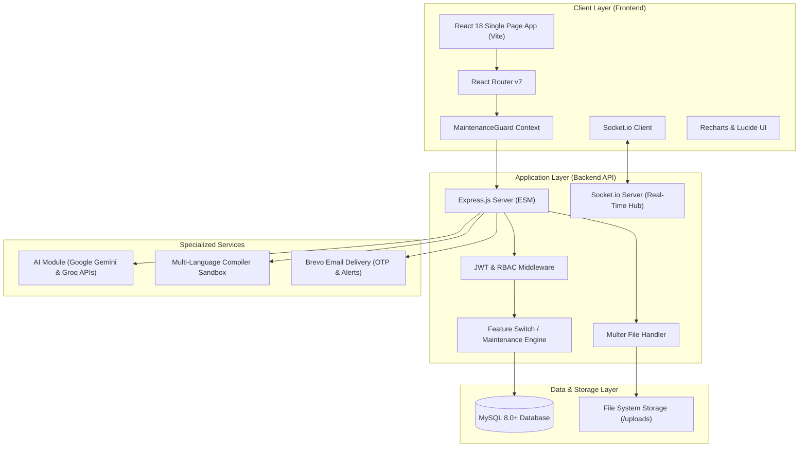

# TrainX: Campus Training Portal
## Comprehensive System Architecture & Technical Documentation

---

**Document Title**: TrainX Campus Training Portal Technical Specification & System Documentation  
**Version**: 1.0.0  
**Target Audience**: Developers, System Architects, Institutional Administrators, Mentors, and Stakeholders  
**Status**: Active Production Reference  
**Last Updated**: October 2026  

---

## 1. Executive Summary

The **Campus Training Portal (TrainX)** is an AI-augmented, multi-tenant educational and training management ecosystem engineered for universities, colleges, and enterprise training organizations. The platform bridges the skill gap between academia and corporate hiring standards through automated assessments, customized AI learning roadmaps, interactive coding environments, simulated technical interviews, and institutional analytics.

### Key Objectives
* **Standardize Training Across Campuses**: Centralize curriculum, attendance tracking, and performance monitoring across colleges, departments, and batches.
* **Democratize AI-Driven Mentorship**: Provide 24/7 personalized career guidance, mock interviews, and skill diagnostics via Google Gemini and Groq LLMs.
* **Automate Institutional Operations**: Eliminate manual tracking of attendance, defaulters, quiz grading, and assignment delivery.
* **Accelerate Campus to Corporate (C2C) Transitions**: Prepare final- and pre-final-year students for corporate placement drives through structured practice and simulated environments.

---

## 2. System Architecture

TrainX is built following a decoupled, layered client-server architecture with asynchronous real-time event distribution and sandboxed execution capabilities.



---

## 3. Technology Stack Specification

### 3.1 Frontend Architecture
* **Core Framework**: React 18.x with Vite bundling for rapid HMR and optimized production trees.
* **Routing**: React Router v7 with dynamic route guards and lazy-loaded role modules.
* **Styling Paradigm**: Bespoke CSS Design System utilizing CSS custom properties (variables), responsive flex/grid layouts, glassmorphism filters, and semantic color palettes.
* **Icons & Visuals**: `lucide-react` for iconography.
* **Data Visualization**: `recharts` for progress tracking, leaderboard rankings, and performance radar charts.
* **Data Import/Export**: `xlsx` (SheetJS) for bulk user and attendance spreadsheets.
* **Real-Time Client**: `socket.io-client` for instant announcements and banner notifications.

### 3.2 Backend Architecture
* **Runtime**: Node.js (configured for native ES Modules with `"type": "module"`).
* **Web Server Framework**: Express.js with structured controllers, route modules, and error-handling pipelines.
* **Database Driver**: `mysql2/promise` configured with connection pooling for concurrent database queries.
* **Security & Auth**:
  * JSON Web Tokens (`jsonwebtoken`) for stateless session verification.
  * `bcryptjs` for salted cryptographic password hashing.
  * Rate-limiting and CORS security configurations.
* **Real-Time Layer**: `socket.io` enabling broadcast rooms for colleges, batches, and specific roles.
* **Communications**: `@getbrevo/brevo` for transactional emails, password reset flows, and one-time passwords (OTP).

### 3.3 Artificial Intelligence Infrastructure
* **Primary LLMs**: Google Gemini API (`@google/genai`) and Groq API for sub-second text and structured JSON responses.
* **AI Pipelines**:
  * `roadmap.ai.js`: Generation of milestone-driven career roadmaps.
  * `interview.ai.js`: Real-time AI mock interview question generation and response scoring.
  * `quiz.ai.js`: Automatic extraction of multiple-choice question sets with distractors.
  * `skillGap.ai.js`: Diagnostic analysis synthesizing test scores and coding evaluations.

---

## 4. Role-Based Access Control (RBAC) & User Journeys

The platform defines five distinct roles with strictly isolated permissions:

```
Super Admin  ──►  College Admin  ──►  Coordinator  ──►  Mentor  ──►  Student
(System-wide)    (Institution)       (Department)      (Batch)      (Learner)
```

### 4.1 Super Admin
* **Entity**: System Owner / Platform Operator.
* **Capabilities**:
  * Register, audit, activate, and deactivate colleges across the platform.
  * Global user approval queue (authorizes College Admins and bulk registrations).
  * Real-time **System Health Monitoring** (host memory, CPU load, database latency, process uptime).
  * **Feature Maintenance Controls**: Toggle individual functional modules (e.g., AI interviews, online coding compiler, student leaderboard) on or off dynamically without server restarts.
  * Escalated support ticket management.

### 4.2 College Admin
* **Entity**: Institutional Dean, Principal, or Training & Placement Officer (TPO).
* **Capabilities**:
  * Configure academic departments, batch assignments, and academic years.
  * Manage institution users with bulk Excel upload capabilities (`.xlsx`).
  * Oversee Campus-to-Corporate (C2C) student cohorts and program enrollments.
  * Campus-wide attendance summaries, defaulter threshold reports, and quiz outcomes.
  * Issue institutional broadcast announcements.

### 4.3 Coordinator
* **Entity**: Department Head or Training Coordinator.
* **Capabilities**:
  * Allocate mentors to batches and monitor syllabus delivery.
  * Identify **Students Needing Improvement** via automated performance flags.
  * Track placement drive readiness, company-specific preparation modules, and interview performances.
  * Review leave requests and student attendance disputes.

### 4.4 Mentor / Trainer
* **Entity**: Faculty Instructor, Corporate Trainer, or Technical Coach.
* **Capabilities**:
  * Host live video training sessions with calendar schedules and meeting URLs.
  * Upload and curate subject study materials (PDFs, slide decks, reference links).
  * Conduct lecture attendance with digital presence marking.
  * Publish targeted quizzes, homework tasks, and algorithmic coding challenges.
  * Review individual student progress cards, AI interview rubrics, and diagnostic skill gaps.

### 4.5 Student
* **Entity**: Candidate / Learner.
* **Capabilities**:
  * Access enrolled batch curriculum, upcoming lectures, and shared study materials.
  * Generate personalized **AI Learning Roadmaps** based on targeted career tracks (e.g., Full Stack, AI/ML, Cloud DevOps).
  * Conduct simulated **AI Mock Interviews** with prompt evaluations and rubric-based feedback.
  * Solve DSA problems on the **Interactive Coding Platform** with automated test case evaluation.
  * Attempt timed academic quizzes and view real-time leaderboard standings.
  * Monitor personal attendance percentage, review defaulter warnings, and submit leave applications.

---

## 5. Core Subsystems & Technical Implementation

### 5.1 Authentication & Registration Flow
1. **Direct Registration**: Candidates register with university email, mobile number, college, and department.
2. **Approval Gateway**: New student and faculty accounts are queued for verification by their respective College Admin or Super Admin.
3. **Passwordless / OTP Verification**: Brevo API issues time-limited 6-digit OTPs (`otps` table) with automatic expiry.
4. **Token Generation**: Upon successful authentication, a signed JWT containing `userId`, `role`, and `collegeId` is issued to the client.

### 5.2 Dynamic Maintenance & Feature Switch Subsystem
TrainX implements high-availability governance via the **Maintenance Guard** architecture:
* **Feature Switch Engine (`featureSwitch.controller.js`)**: Maintains persistent toggles for individual modules:
  * `aiRoadmaps`, `aiInterviews`, `codingCompiler`, `academicQuizzes`, `attendance`, `studentLeaderboard`, etc.
* **MaintenanceGuard (`MaintenanceGuard.jsx`)**: Higher-order React component wrapping each route. If a module's switch is marked inactive by Super Admin, users navigating to that route are shown a dedicated maintenance screen explaining temporary maintenance while leaving all other modules accessible.

### 5.3 Online Coding Platform & Execution Sandbox
* **Editor**: Integrated web-based code editor with syntax highlighting, language selector (C++, Java, Python, JavaScript), and input buffer.
* **Test Case Engine**: Evaluates submissions against both public (sample) and private (hidden) test cases.
* **Sandbox Execution**: Code is forwarded to the isolated backend compiler runner to prevent malicious script injection and infinite loops via strict timeout and memory limits.

### 5.4 AI Interview & Skill Gap Diagnostic Pipeline
* **Interview Session**:
  1. Student selects technical domain (e.g., Frontend React, Java Backend, System Design).
  2. The AI module (`interview.ai.js`) generates tailored behavioral and technical questions.
  3. Student answers via text or voice transcription.
  4. Model analyzes response completeness, technical depth, and communication skills, returning a scored rubric.
* **Skill Gap Aggregator (`skillGap.ai.js`)**: Combines quiz history, coding problem failures, and interview performance into a comprehensive JSON report stored in `skill_gap_analysis`, listing concrete remediation recommendations.

---

## 6. Database Schema Reference (`training_portal_db`)

The relational schema is structured with strong foreign key referential integrity:

| Table Name | Primary Purpose | Key Relationships |
| :--- | :--- | :--- |
| `colleges` | Stores institution details and codes | Parent to `departments`, `batches`, `users` |
| `departments` | Academic divisions within colleges | References `colleges(id)` |
| `batches` | Training cohorts and schedules | References `colleges(id)`, `departments(id)` |
| `student_batches` | Batch enrollment cross-table | Maps `users(id)` $\leftrightarrow$ `batches(id)` |
| `users` | Global identity and credentials | References `colleges(id)` |
| `students` | Detailed academic profile (roll no, CGPA) | Foreign key to `users(id)` |
| `assessments` | Quiz and exam definitions | References `colleges(id)`, `batches(id)` |
| `assessment_questions` | Question banks with options and keys | Foreign key to `assessments(id)` |
| `assessment_attempts` | Student quiz submissions and scores | References `assessments(id)`, `users(id)` |
| `attendance_sessions` | Lecture attendance instances | References `batches(id)`, `users(faculty_id)` |
| `attendance` | Individual attendance records | References `attendance_sessions(id)`, `users(id)` |
| `attendance_summary` | Cached attendance statistics & status | Foreign key to `users(id)` |
| `practice_problems` | Coding problem definitions and points | References `batches(id)`, `users(created_by)` |
| `live_sessions` | Scheduled video lectures and URLs | References `users(mentor_id)` |
| `study_materials` | Resource file URLs and subjects | References `users(uploaded_by)` |
| `leave_requests` | Student absence applications | References `users(id)` |
| `support_tickets` | User helpdesk tickets | References `users(id)` |
| `skill_gap_analysis` | JSON-driven AI diagnostic reports | Foreign key to `users(id)` |
| `broadcast_notifications`| Institution announcements | References `colleges(id)` |
| `otps` | Temporary verification keys | Keyed by user email and expiration |

---

## 7. API Architecture & Key Endpoints

All endpoints are prefixed with `/api` and secured with JWT validation:

### Authentication & Users
* `POST /api/auth/login` — User authentication with password.
* `POST /api/auth/register` — Initial user account registration.
* `POST /api/auth/send-otp` — Generates and delivers Brevo email OTP.
* `POST /api/auth/verify-otp` — Validates OTP for login/recovery.

### Student & Learning
* `GET /api/student/dashboard` — Aggregated metrics for student overview.
* `POST /api/roadmap/generate` — Invokes LLM pipeline for dynamic career roadmaps.
* `GET /api/assessment` — Lists available quizzes for student's batch.
* `POST /api/assessment/:id/submit` — Submits quiz answers and records score.
* `POST /api/interview/start` — Initializes an AI mock interview session.
* `POST /api/interview/submit` — Submits candidate answers for evaluation.
* `GET /api/skill-gap` — Fetches personalized diagnostic skill report.

### Coding & Practice
* `GET /api/coding/problems` — Retrieves list of programming problems.
* `POST /api/coding/run` — Executes code against sample test cases in the sandbox.
* `POST /api/coding/submit` — Submits code for automated grading against hidden cases.

### Attendance & Sessions
* `POST /api/attendance/session` — Mentor creates lecture attendance session.
* `POST /api/attendance/mark` — Records student attendance states (present/absent/late).
* `GET /api/attendance/summary/:userId` — Retrieves percentage and attendance status.
* `GET /api/attendance/defaulters` — Lists students below compliance threshold (<75%).

### Administration & Health
* `GET /api/system-health` — Real-time telemetry (RAM, CPU, database).
* `GET /api/feature-switch` — Current status of all module switches.
* `POST /api/feature-switch/toggle` — Super Admin toggles subsystem maintenance.

---

## 8. Deployment & Operational Runbook

### Prerequisites
* **Node.js**: v18.0.0 or higher
* **npm**: v9.0.0 or higher
* **MySQL**: v8.0 or higher
* **Docker Engine** (Optional, for containerized sandbox compilation)

### Quickstart Execution
```bash
# 1. Install root, backend, and frontend dependencies
npm run install-all

# 2. Database Initialization
# Create database 'training_portal_db' and run database/schema/schema.sql

# 3. Environment Setup
cp .env.example Backend/.env
# Update DB credentials, JWT_SECRET, Brevo API key, and Gemini/Groq keys

# 4. Start Development Cluster
npm run dev
# Backend boots on http://localhost:5000
# Frontend boots on http://localhost:5173
```

---

*Authored by TrainX Engineering Team — Reference Documentation.*
